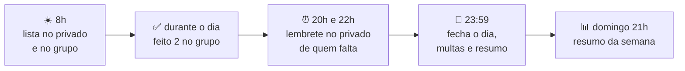
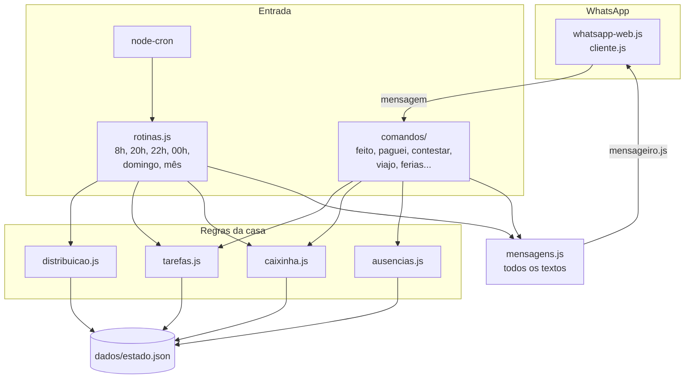

# 🏠 Bot da Casa

Bot de WhatsApp que organiza as tarefas de uma república: divide o trabalho de forma justa, manda a lista do dia, lembra quem esqueceu, aplica multas que só dão baixa com comprovante e recompensa quem melhora com descontos.


---

## Sumário

- [O problema](#o-problema)
- [O que o bot faz](#o-que-o-bot-faz)
- [Como é um dia com o bot](#como-é-um-dia-com-o-bot)
- [Regras da casa](#regras-da-casa)
- [Como a divisão justa funciona](#como-a-divisão-justa-funciona)
- [Arquitetura](#arquitetura)
- [Decisões técnicas](#decisões-técnicas)
- [Rodando o projeto](#rodando-o-projeto)
- [Comandos](#comandos)
- [Testes](#testes)
- [Colocando num servidor](#colocando-num-servidor)
- [Limitações e próximos passos](#limitações-e-próximos-passos)

---

## O problema

Numa república com três moradoras, a divisão das tarefas já tinha sido feita várias vezes: escala por zonas, quadro na geladeira, combinados no grupo. Nenhuma funcionou por muito tempo. A louça acumulava, o lixo ficava, e quem se importava mais com a limpeza acabava fazendo a parte das outras e ainda tendo que cobrar.

O problema não era a divisão. Faltavam três coisas:

1. **Visibilidade**: saber exatamente o que é de quem, todo dia, e ver quem já fez.
2. **Consequência**: algo acontecer quando uma tarefa fica para trás, sem depender de alguém cobrar.
3. **Justiça percebida**: ninguém sentir que está fazendo mais do que as outras.

O Bot da Casa cuida dessas três coisas sozinho, dentro do WhatsApp que todo mundo já usa, sem precisar instalar outro app.

## O que o bot faz

- 📋 **Monta a lista do dia** às 8h: cada moradora recebe a sua no privado e o grupo recebe a de todas.
- ⚖️ **Divide as tarefas pelo esforço**, não por rodízio fixo: cada tarefa vale pontos e a próxima vai para quem tem menos.
- ✅ **Recebe o "feito" no grupo**, e a louça só pode ser marcada depois das 20h (para valer a do dia inteiro).
- ⏰ **Lembra no privado** às 20h e às 22h, só quem ainda tem tarefa pendente.
- 🌙 **Fecha o dia às 23:59**: o que ficou vira multa, continua com a mesma pessoa no dia seguinte e o grupo vê o resumo.
- 📸 **Contestação anônima**: se alguém marcou "feito" sem fazer, outra moradora manda uma foto no privado do bot e a tarefa volta para a lista.
- 💸 **Caixinha com comprovante**: a multa só dá baixa com a foto ou o PDF do Pix, e o mesmo comprovante não vale duas vezes.
- 🎁 **Descontos e anistia** para quem passa semanas e meses sem multa.
- 📅 **Cobra sozinho**: fechamento do mês, lembrete no dia do vencimento e nova cobrança sem desconto para quem atrasou.
- ✈️ **Viagens e férias**: quem viaja sai do rodízio; nas férias a casa fecha e o bot fica em silêncio.

## Como é um dia com o bot



Exemplos reais das mensagens (gerados pelo próprio bot com a configuração de exemplo):

<table>
<tr>
<td valign="top">

**No grupo, às 8h**
```
🏠 Tarefas de quarta, 09/12

Ana
▫️ 1. Limpar a caixa de areia dos gatos
▫️ 2. Limpar mesa, balcões da cozinha e
      do corredor, fogão e tirar o pó do
      rack da TV
▫️ 5. Limpar a geladeira e jogar fora o
      que venceu
▫️ 7. Lavar a sua louça (marcar após 20:00)

Bia
▫️ 4. Lavar a área
▫️ 8. Lavar a sua louça (marcar após 20:00)

Carol
▫️ 3. Passar pano no chão
▫️ 6. Varrer ou aspirar a casa
▫️ 9. Lavar a sua louça (marcar após 20:00)

Para marcar: mande feito 3 aqui no grupo
(ou feito 1 4). Prazo: 23:59.
```

</td>
<td valign="top">

**No privado, às 8h**
```
☀️ Bom dia, Bia! Suas tarefas de hoje:

▫️ 4. Lavar a área
▫️ 8. Lavar a sua louça (marcar após 20:00)

Quando terminar, marque no grupo: feito 4.
Prazo: 23:59.

🔥 4 semanas limpas seguidas
   (desconto de 50%, o máximo!)
```

**No grupo, à meia-noite**
```
🌙 Fechamento do dia: ficou para trás

Carol
• Lavar a sua louça: multa R$ 8,00

✅ Ana e Bia fizeram tudo!
```

</td>
</tr>
<tr>
<td valign="top">

**No grupo, no fim do mês**
```
📅 Fechamento de dezembro

Ana: nenhuma multa! 🌟
   ✅ nada a pagar
Bia: nenhuma multa! 🌟
   ✅ nada a pagar
Carol: R$ 8,00 em multas
   🎁 desconto de 20% (1 semana limpa):
      -R$ 1,60
   👉 a pagar: R$ 6,40

Vencimento: 08/01. Quem não pagar até lá
perde o desconto do mês.
```

</td>
<td valign="top">

**Pagamento no grupo** (foto do Pix com a legenda `paguei 5`)
```
✅ Pagamento de R$ 5,00 registrado, Bia!
Agora você deve R$ 3,00.
```

</td>
</tr>
</table>

## Regras da casa

As regras foram definidas junto com as moradoras e ficam todas configuráveis no `config.js`.

### Tarefas

| Frequência | Tarefas (multa) |
|---|---|
| Todo dia | Varrer ou aspirar (R$ 3) · Cozinha, mesa e rack da TV (R$ 4) · Sua louça, individual (R$ 8) · Caixa de areia, em rodízio só entre as donas dos gatos (R$ 2) |
| A cada 2 dias | Passar pano (R$ 3) · Tirar o lixo (R$ 5) |
| A cada 3 dias | Lavar a área (R$ 4) · Banheiro, só entre quem usa o banheiro social (R$ 6) |
| Toda semana | Geladeira (R$ 4) · Micro-ondas (R$ 2) · Lavar e estender panos e tapetes (R$ 4) · Recolher, dobrar e guardar, sempre outra pessoa (R$ 4) |

### Atrasos

- A tarefa que não foi feita **continua com a mesma pessoa** no dia seguinte, **por cima** das tarefas normais dela. Quem atrasa não recebe menos tarefas novas por causa disso.
- Se ficar de novo, a multa **dobra** (só uma vez, para não virar uma dívida que ninguém paga).
- Se a mesma tarefa cair de novo no dia seguinte (como varrer), ela vira uma só: *"Varrer (a de ontem + a de hoje)"*.
- Tarefa atrasada não pode ser trocada.

### Contestação

Quem vê que uma tarefa foi marcada sem ser feita manda no **privado do bot** uma foto com a legenda `contestar Bia 2`. A tarefa volta para a lista da pessoa e o grupo é avisado **sem saber quem contestou**. Se não for refeita até 23:59, vira multa normal.

### Caixinha

- Pagamento só vale com **comprovante** (foto, print ou PDF). O bot guarda um hash de cada arquivo e recusa comprovante repetido.
- **Calendário:** no fim do mês o bot manda quanto cada uma deve, já com desconto. O vencimento é no **dia 8**. Quem não quitar perde o desconto e, no **dia 10**, recebe a cobrança com o valor cheio.
- Quem tem crédito suficiente para cobrir as multas não precisa pagar nada e mantém o desconto.

### Descontos e anistia

- **Semana limpa** é uma semana (segunda a domingo) sem nenhuma multa.
- No fim do mês, conta-se a sequência de semanas limpas até o último domingo: **1 semana = 20%**, **2 = 35%**, **3 ou mais = 50%** de desconto sobre as multas do mês.
- O desconto vira **crédito**, que abate as próximas multas. Assim, pagar antes não faz perder o desconto. Ninguém fica com mais de **R$ 15** de crédito.
- **Anistia:** quem fecha **2 meses seguidos sem multa** recebe de volta, em crédito, o que realmente pagou de multas no mês anterior à sequência. Só vale se aquelas multas foram pagas, e o desconto que já tinha ganhado sai da conta.

> **Exemplo:** multa de R$ 8 na 3ª semana, com R$ 4 de crédito. A 4ª semana é limpa, então ela ganha 20% (R$ 1,60) e deve R$ 2,40 até o dia 8. Se não pagar, perde os 20% e passa a dever R$ 4.

### Viagens e férias

- **Viagem individual** (`viajo 14/11 a 17/11`): avisada com 24h de antecedência, vale na hora; em cima da hora, quem fica em casa confirma. Quem viaja não recebe tarefas nem multas, e **não há compensação na volta**.
- **Férias** (`ferias 20/12 a 15/01`): as três confirmam. Na véspera tem uma faxina de saída (lixo, geladeira, cozinha) e, na volta, uma de chegada (pó e pano). No meio, nenhuma mensagem.
- Semanas com menos de 4 dias em casa e meses com menos de 15 ficam **neutros**: não contam para o desconto nem quebram a sequência.

## Como a divisão justa funciona

Um rodízio fixo ("cada semana uma zona") não funciona bem quando as tarefas têm pesos e frequências diferentes: lavar o banheiro a cada 3 dias não é o mesmo que tirar o lixo. Então cada tarefa tem **pontos de esforço**, e o bot distribui de forma **gulosa**:

1. Junta as tarefas que caem no dia (pela frequência e pelo deslocamento de cada uma, a partir de uma data de referência).
2. As **atrasadas** de ontem voltam para quem atrasou. Os pontos delas já foram contados quando a tarefa foi distribuída, então não entram de novo na conta.
3. As **fixas** vão sempre para a mesma responsável e não entram na conta de pontos.
4. As de **rodízio** são ordenadas da mais pesada para a mais leve, e cada uma vai para quem tem **menos pontos acumulados** (histórico + o que já recebeu hoje). Há duas restrições:
   - tarefas restritas a algumas pessoas (banheiro) alternam pelo número de vezes;
   - "quem estende a roupa não recolhe" (`diferenteDe`);
   - tarefas **fora do equilíbrio** (`foraDoEquilibrio`) só alternam entre as pessoas, sem contar pontos. É o caso da caixa de areia: só as donas dos gatos se revezam, e quem não tem gato não recebe outras tarefas a mais para compensar.
5. As **individuais** (louça) vão para cada uma que está em casa.

Empates são decididos por uma ordem que gira a cada dia, para a mesma pessoa não ganhar sempre. Em 4 semanas de simulação, os pontos ficam praticamente empatados (98, 99 e 97), mesmo com a Bia fora do rodízio do banheiro: ela compensa pegando mais das outras tarefas.

**Viagem sem compensação:** quem está viajando ganha a média de pontos do dia, como se tivesse feito a parte dela. Assim ela não volta com uma pilha de tarefas, e as outras não ficam "devendo" pontos.

```
npm run simular        # mostra a primeira semana e o placar de 4 semanas
npm run simular -- 8   # 8 semanas
```

## Arquitetura



```
bot-casa/
├── config.exemplo.js        # configuração de exemplo (copie para config.js)
├── src/
│   ├── index.js             # liga o WhatsApp, agenda as rotinas, recebe mensagens
│   ├── configuracao.js      # carrega o config.js e completa com as regras padrão
│   ├── estado.js            # carrega e salva o dados/estado.json
│   ├── mensagens.js         # todos os textos que o bot manda
│   ├── rotinas.js           # o que acontece em cada horário
│   ├── casa/                # regras de negócio, sem nada de WhatsApp
│   │   ├── distribuicao.js  # monta o dia e decide quem faz o quê
│   │   ├── tarefas.js       # feito, contestação, trocas e fechamento do dia
│   │   ├── caixinha.js      # saldo, pagamentos, créditos, descontos e anistia
│   │   └── ausencias.js     # viagens, férias e propostas
│   ├── comandos/            # um arquivo por assunto, cada comando é uma função
│   │   ├── index.js         # identifica quem mandou e chama o comando
│   │   ├── tarefas.js
│   │   ├── caixinha.js
│   │   └── ausencias.js
│   ├── whatsapp/
│   │   ├── cliente.js       # cliente do WhatsApp Web
│   │   ├── mensageiro.js    # enviar para o privado, para o grupo, para todas
│   │   ├── midia.js         # baixar e guardar comprovantes e fotos
│   │   └── remetente.js     # descobrir qual moradora mandou a mensagem
│   └── util/                # datas, textos e log
├── scripts/simular.js       # simula semanas de divisão sem WhatsApp
├── test/                    # testes automáticos (node:test)
└── servidor/                # instalação num servidor Linux com pm2
```

A pasta `casa/` não sabe que o WhatsApp existe: recebe o estado e devolve resultados. Os comandos e as rotinas recebem um **contexto** (`estado`, `mensageiro`, `agora()` e `salvar()`), e isso permite testar o bot inteiro com um WhatsApp falso e um relógio controlado.

## Decisões técnicas

- **whatsapp-web.js em vez da API oficial.** A API oficial da Meta cobra por conversa iniciada pela empresa e exige conta business verificada, o que não faz sentido para três pessoas. A biblioteca não oficial abre o WhatsApp Web num Chromium escondido e funciona no grupo que elas já usam. O custo é o risco de o número ser bloqueado, por isso o bot usa um número só dele.
- **Estado em um arquivo JSON.** Para uma casa, um banco de dados seria peso sem ganho. O estado é salvo de forma atômica (grava num arquivo temporário e renomeia), então uma queda no meio da gravação não corrompe os dados. Há backup diário no servidor.
- **Datas como texto `AAAA-MM-DD`.** Dá para comparar com `<` e `>`, salvar no JSON sem conversão e evitar os problemas de fuso e horário de verão de objetos `Date`. As contas usam meio-dia UTC.
- **Contestação anônima.** O nome de quem contestou fica guardado só no estado, para consulta. Nenhuma mensagem mostra, e contestar no grupo é recusado.
- **Comprovante com hash.** Cada comprovante recebe um SHA-256, e o mesmo arquivo não pode quitar duas multas. Os arquivos ficam salvos em `dados/comprovantes`, caso alguém conteste.
- **Recuperação.** Se o bot estava desligado na virada do dia ou do mês, ao ligar ele fecha os dias que ficaram abertos (aplicando as multas) e faz as rotinas do mês que ficaram para trás, sem duplicar mensagens (marcações em `estado.meses`).
- **Dados pessoais fora do Git.** O `config.js` com os telefones de verdade fica no `.gitignore`; o repositório só tem o `config.exemplo.js`, com dados fictícios.

## Rodando o projeto

**Requisitos:** Node.js 18 ou mais novo e um número de WhatsApp só para o bot (um chip ou eSIM pré-pago, com o WhatsApp Business instalado).

```bash
git clone https://github.com/nevoa19/bot-amelia.git bot-casa
cd bot-casa
npm install
cp config.exemplo.js config.js   # no Windows: copy config.exemplo.js config.js
```

Edite o `config.js`: nomes e telefones das moradoras, nome exato do grupo, chave Pix da caixinha, tarefas, frequências e multas.

```bash
npm run simular   # confere a divisão antes de ligar
npm start         # liga o bot e mostra o QR Code
npm run testar    # liga e já manda a mensagem do dia
```

Na primeira vez, escaneie o QR Code com o WhatsApp do bot: **Configurações > Dispositivos conectados > Conectar dispositivo**. A sessão fica salva em `dados/sessao`.

## Comandos

| Comando | Onde | O que faz |
|---|---|---|
| `feito 2` / `feito 1 3` | grupo | marca as tarefas como feitas |
| `tarefas` / `hoje` | qualquer | suas tarefas de hoje / as de todo mundo |
| `trocar 2 Bia`, `aceito`, `recuso` | qualquer | troca de tarefa, só vale se a outra aceitar |
| `contestar Bia 2` + foto | privado | contestação anônima de uma tarefa marcada sem fazer |
| `multas` | qualquer | saldo, créditos e sequência de semanas limpas de cada uma |
| `paguei 8` + comprovante | qualquer | dá baixa no pagamento e responde quanto ainda falta |
| `viajo 14/11 a 17/11`, `voltei` | qualquer | viagem individual |
| `ferias 20/12 a 15/01`, `cancelar ferias` | qualquer | férias da casa toda, com confirmação de todas |
| `confirmo` / `rejeito` | qualquer | responde a uma proposta de férias ou viagem |
| `ajuda` | qualquer | lista os comandos |

Os comandos não diferenciam maiúsculas nem acentos (`Férias` e `ferias` funcionam igual). No privado, qualquer mensagem que o bot não entende mostra a ajuda; no grupo, ele fica quieto.

## Testes

```bash
npm test
```

São 65 testes com o `node:test` (nativo do Node, sem dependências), usando a configuração de exemplo e um WhatsApp falso que só anota as mensagens enviadas:

| Arquivo | O que garante |
|---|---|
| `datas.test.js` | leitura de datas como "20/12 a 15/01", virada de ano, fuso |
| `distribuicao.test.js` | equilíbrio dos pontos, banheiro restrito, caixa de areia fora do equilíbrio, quem estende não recolhe, atrasada fica com a mesma pessoa e não muda a divisão futura, multa dobrada |
| `tarefas.test.js` | louça só depois das 20h, contestação, trocas |
| `caixinha.test.js` | descontos por sequência, teto de crédito, vencimento, anistia só do que foi pago |
| `ausencias.test.js` | antecedência, confirmações, faxinas das férias, viagem sem compensação, semanas neutras |
| `comandos.test.js` | mensagens de verdade: feito no grupo, contestação anônima, pagamento com e sem comprovante, comprovante repetido |
| `rotinas.test.js` | manhã, lembretes, fechamento do dia, calendário do mês (fim do mês, dia 8, dia 10), silêncio nas férias |
| `remetente.test.js` | reconhece a moradora pelo telefone, inclusive quando o WhatsApp manda o id interno (`@lid`) em vez do número |

Para conferir se os testes pegam erros de verdade, alguns bugs foram inseridos de propósito no código (contestação revelando o nome, multa crescendo todo dia, comprovante repetido aceito etc.), e cada um fez pelo menos um teste falhar.

## Colocando num servidor

Para o bot rodar 24h sem depender de um computador ligado, a pasta `servidor/` tem tudo para uma máquina Linux (testado no Ubuntu):

- `instalar.sh` instala Node, Chromium, pm2 e o backup diário;
- `conectar.sh` faz a conexão pelo QR Code (usando o `login.js`, que contorna a página nova de login do WhatsApp Web) e liga o bot;
- `ecosystem.config.js` configura o pm2 para religar o bot se ele cair ou se o servidor reiniciar.

O passo a passo completo, usando a camada gratuita da Oracle Cloud, está em [`servidor/GUIA-SERVIDOR.md`](servidor/GUIA-SERVIDOR.md).

## Limitações e próximos passos

- **Biblioteca não oficial:** o WhatsApp pode mudar o WhatsApp Web e quebrar a biblioteca até ela ser atualizada, ou bloquear o número do bot.
- **Comprovante não é conferido no banco:** o bot garante que existe um comprovante e que ele não foi reaproveitado, mas um print editado passaria. Quem guarda a caixinha confere pelo extrato.
- **Uma casa por instância:** a configuração é de uma casa só.

Ideias para o futuro:

- painel web com o histórico de tarefas, multas e a caixinha;
- ler o valor do comprovante automaticamente (OCR) para conferir com o `paguei`;
- ranking mensal e conquistas para deixar a parte boa mais visível do que as multas.

## Licença

Distribuído sob a [PolyForm Noncommercial 1.0.0](https://polyformproject.org/licenses/noncommercial/1.0.0). Veja o arquivo [`LICENSE`](LICENSE).

Em resumo: você pode ler, estudar, testar e usar o código para fins **não comerciais**, como uso pessoal, estudo ou na sua própria casa, e também modificá-lo para esses fins. **Não é permitido** vender o bot, usá-lo em produto ou serviço comercial nem sublicenciá-lo. Para qualquer uso comercial, fale comigo.

---

Feito por **Maria Antonia Baraldi Névoa** ([@nevoa19](https://github.com/nevoa19)).
